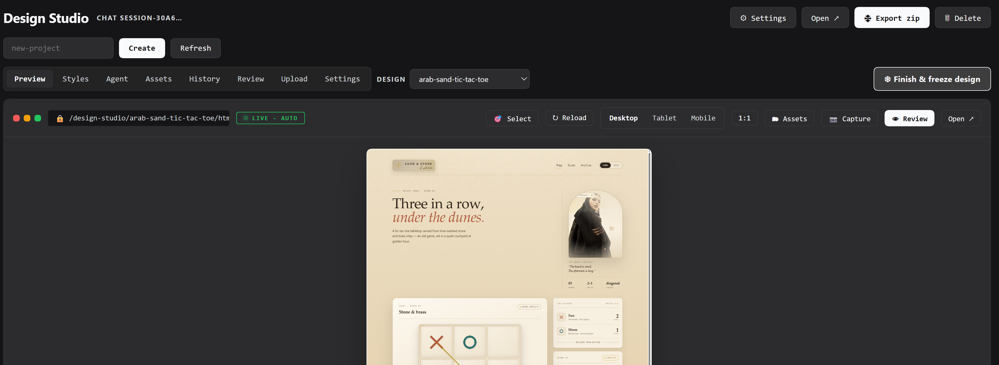
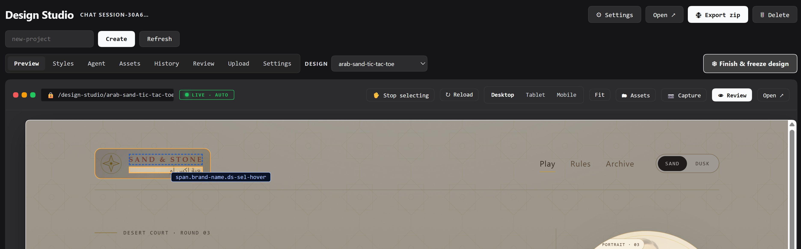
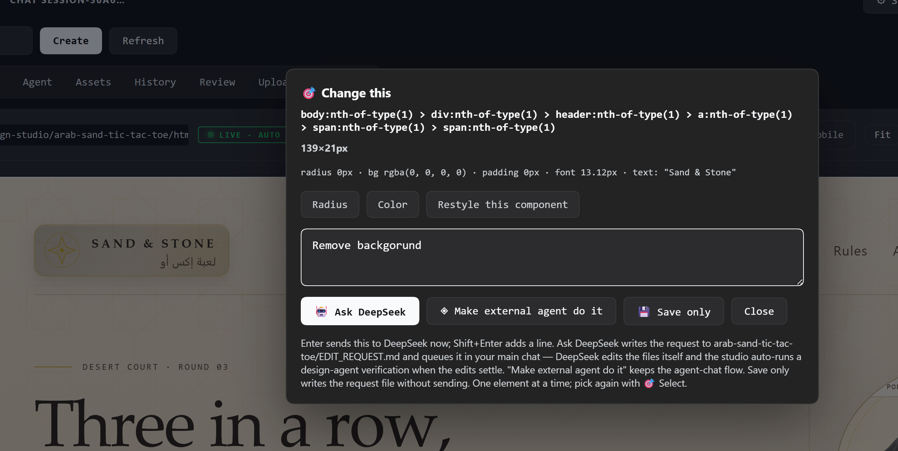
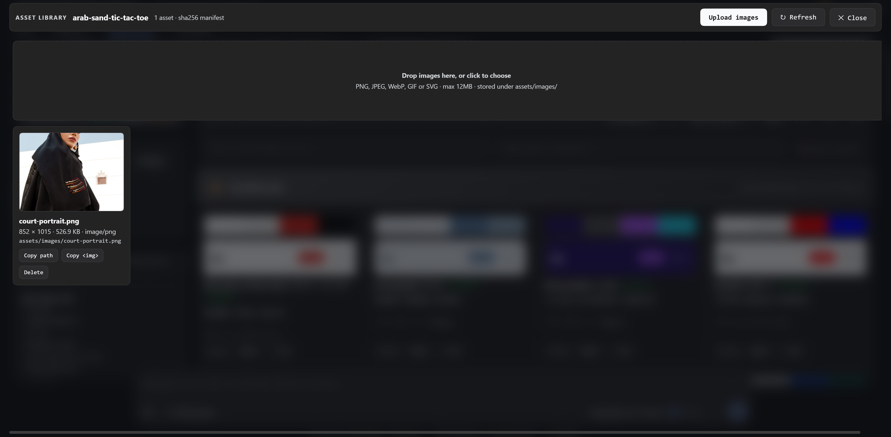
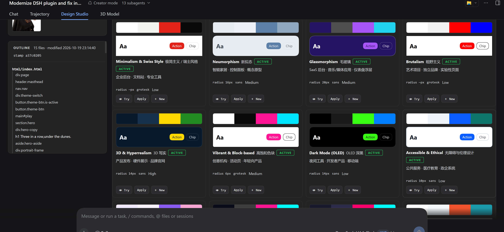
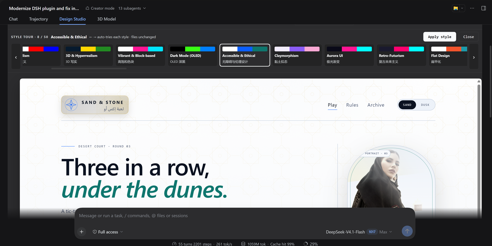
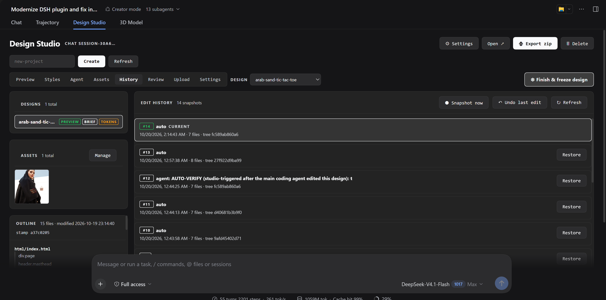

# @sal7one/dsh-design-studio

A **DeepSeek Harness plugin** that turns design mockups into a first-class AI workflow.
Live previews, an element picker, a real design agent, vision review, identity presets —
and a two-agent apply flow where **DeepSeek edits and the design agent verifies**.
Everything is backed by real files under `temp_design_folder/`, and everything is
**launch-persistent**: install once, the Design Studio tab is there on every launch.

> **2.6.1 — project selector for freeze.** Freeze defaults to the current
> conversation project; choose This project/Recent/Other path from a selector.
> No path typing required.
>
> **2.6.0 — design freeze.** A large **Finish & freeze design** handoff marks the
> mockup read-only, records the implementation target, blocks Studio/AI writes,
> and switches the agent to implementation mode until an explicit Thaw.
>
> **2.5.0 — agent handbook + skill.** Added a repo-local Design Studio handbook,
> a reusable `design-studio` skill, and `AGENTS.md` guidance. Not installed into
> the DSH profile yet.
>
> **2.4.6 — assets top spacing.** The full-screen Asset library starts below the
> OS/window controls, so Upload/Refresh/Close no longer overlap them.
>
> **2.4.5 — cancel delete.** Arming Delete now shows a Cancel button, so the
> confirmation can be dismissed without switching tabs.
>
> **2.4.4 — tab row spacing.** The workspace tab row now has breathing room above
> it instead of sitting flush against the Create row.
>
> **2.4.3 — vision warning.** The selection editor warns when the active model
> has no image input and no OpenRouter fallback is configured, so you know that
> DeepSeek will edit from files only and cannot visually verify the result.
>
> **2.4.2 — Enter asks DeepSeek.** In the selection editor, Enter now sends the
> change to **Ask DeepSeek**; Shift+Enter adds a line, and Save only remains an
> explicit “don’t send” action.
>
> **2.4.1 — run banner lifecycle.** The Ask-DeepSeek banner now polls the session
> binding so a finished run clears on its own; unobserved pickups fall back to
> “watch the main chat” and finished/untracked banners auto-dismiss after 8s.
>
> **2.4.0 — style tour and safe applies.** The Styles grid gets a large **Try them
> now** button that opens a horizontal style tour over the current design; arrow
> keys auto-try each style. The tour sits above the preview and has a **Fit**
> toggle that scales and centers the whole preview so the page does not scroll;
> the strip scrolls horizontally on its own. Random-next preview, one-click Undo
> apply backed by a pre-style snapshot, and auto snapshots after AI edit
> batches/agent turns.
>
> **2.3.0 — attributed style atlas.** 88 design styles from dsh-ui-ux-pro-max
> (MIT) are vendored as normalized data, then exposed through a **Styles** tab:
> try a style live in the current design, apply tokens, create a new project from
> the full template, save the current `token.css` as a custom style, and shuffle
> fonts/palettes. No runtime dependency on the source repo.
>
> **2.2.0 — content-addressed edit history.** Every design now has a snapshot tree
> (`_studio/history/<slug>/`) with sha256 blobs, sorted tree manifests, parent-linked
> snapshots and a head cursor. Auto-capture runs after edits settle; the **History** tab
> offers undo-last-edit and restore-to-snapshot.
>
> **2.1.0 — settings redesign and file split.** A vision-first Settings page (transport,
> review style, capture viewport, agent preset, auto-verify) and modular host/client
> sources: `lib/host/*` and `lib/client/src/*`, with a zero-dependency bundler that emits
> the committed `lib/client.js`. **Installs still need no build step.**
>
> **2.0.0 — modernized for DSH 0.2.x.** The host now uses the current
> `ctx.subagents.startActivation` contract and `Agent.id`, the client uses the current
> slot registration and Session `prompt()` API, and the plugin no longer shells out to
> `sh`, `curl`, `zip`, `base64` or `screencapture`. The buggy screenshot-capture feature
> and the unused `dynamic/` prototype were removed. See [CHANGELOG.md](CHANGELOG.md).

## Screenshots

<p align="center">
  <a href="repo-images/screenshot-01.png"></a>
  <a href="repo-images/screenshot-02.png"></a>
  <a href="repo-images/screenshot-03.png"></a>
  <a href="repo-images/screenshot-04.png"></a>
  <a href="repo-images/screenshot-05.png"></a>
  <a href="repo-images/screenshot-06.png"></a>
  <a href="repo-images/screenshot-07.png"></a>
</p>

<p align="center"><em>Click any thumbnail for the full-size image.</em></p>

```text
DSH-Design-Studio/
├── package.json          # dual-face manifest: dsh.bundle (host) + dsh.client (web UI)
├── cordis.patch.yml      # the composition layer this bundle contributes
├── README.md             # this file
├── CHANGELOG.md          # release notes (2.3 atlas, 2.2 history, 2.1 split/settings)
├── LICENSE               # MIT
├── THIRD_PARTY_NOTICES.md # style-atlas attribution and MIT notices
├── icon.svg              # plugin inventory artwork
├── locale/               # plugin inventory display metadata (en/zh)
├── repo-images/          # UI screenshots shown at the top of this README
├── lib/
│   ├── data/
│   │   └── style-atlas.json # attributed 88-style snapshot (no runtime dependency)
│   ├── index.js          # host orchestrator: design systems, agent, HTTP route + tool
│   ├── host/             # host domains
│   │   ├── constants.js  # shared limits, key reference, slug regex
│   │   ├── util.js       # pure helpers: zip writer, paths, base64, PNG size
│   │   ├── node-io.js    # Node helper seam, binary writes, delete, browser capture
│   │   ├── config.js     # config load/save, key info, harness vision detection
│   │   ├── vision.js     # harness + OpenRouter review, image descriptions
│   │   ├── preview.js    # headless preview snapshot
│   │   ├── presets.js    # identity preset CRUD + apply
│   │   ├── assets.js     # asset manifest, sha256 dedupe, upload/import/delete
│   │   ├── history.js    # content-addressed blobs, trees, snapshots + restore
│   │   └── styles.js     # style atlas apply/save/create + CSS token generation
│   ├── client.js         # GENERATED self-contained ModuleLoader bundle (shipped)
│   └── client/src/       # runtime, styles, labels, primitives, api, element-picker,
│                         #   scaled-preview, assets-modal, history, style-atlas,
│                         #   studio-view, settings, index
├── scripts/
│   ├── check.mjs         # dependency-free release/check script
│   └── bundle-client.mjs # source → lib/client.js; installs never run it
├── tests/                # host + client smoke tests (node --test)
└── examples/             # example design systems (html/css/js mockups + presets)
```

---

## ✨ Features

### Core platform

- **One command, persistent** — a dual-face `dsh.bundle` + `dsh.client` package:
  `dsh plugin add` once, and the tool, the preview route, the prompt section and the
  **Design Studio tab** are present on every launch. No install-time build step, no
  TypeScript, **zero runtime dependencies** (plain JavaScript); the client source split
  is bundled ahead of release into the committed `lib/client.js`.
- **`design_studio` agent tool** — your assistant (and any subagent) can
  `list / all / create / read / write / zip / reveal / delete / sweep` design systems,
  manage assets (`asset_list / asset_upload / asset_import / asset_delete`), save and
  restore edit history (`history / snapshot_save / snapshot_restore / snapshot_undo`),
  apply/save/create styles (`style_list / style_apply / style_save / style_create`),
  manage identity presets, run vision reviews, chat with the design agent, read its history,
  and configure the studio — all scoped to `temp_design_folder/` design folders.
- **Live preview route** — `/design-studio/<slug>/html/index.html`, served by the
  harness web server. Inline **Preview** is the default open tab and sits in the same
  tab bar as Agent, Assets, Review, Upload and Settings — no modal, no top-right panel.
  It renders a centered device at a real Desktop (1440×1600), Tablet, or Mobile viewport;
  switching viewport resizes the whole device frame, and the surrounding area uses the
  panel background instead of a white strip. The open Studio polls the selected design's
  stamp every 1.5s and auto-reloads the Preview/outline/assets on external edits.
- **Large Studio workspace** — a 300px library (Designs, Assets, Outline) and a wide
  tabbed work area (**Preview / Agent / Assets / Review / Upload / Settings**). The
  Settings and Preview tabs span the full workspace; the standalone Settings page uses a
  two-column layout at wide widths. **Open ↗** is a host action, not a link: it launches
  the OS default browser (`rundll32` / `open` / `xdg-open`), bypassing the DSH in-app
  browser.
- **Design-brief routing** — a system-prompt section turns operator screen briefs into
  design systems automatically. The preview URL is derived from the live server origin.

### Design systems

- **Mockup-scoped files** — every design system is `html/index.html`,
  `css/style.css`, `css/token.css`, `js/app.js` (minimal presentation) plus
  `design_prompts_forcoders.md` (the brief the coding agent follows) and
  `assets/images/` for uploads. Mock data stays honest — empty/loading states,
  never fabricated live numbers.
- **Per-conversation ownership** — each design system is bound to the conversation
  that created it; the tab shows only your chat's designs (unbound legacy systems
  are adopted on first list).
- **Drop zones + asset library** — drop images or code files onto the tab; images land
  in `assets/images/` and auto-select in the agent chat picker. The **🗂 Assets** modal
  uploads by drop/picker, dedupes by sha256, records MIME/dimensions/bytes/alt in
  `assets/assets.json`, and offers thumbnails, a lightbox, copy-path/copy-``, and
  delete. `asset_import` can pull an operator attachment path directly. Preview captures
  are excluded from the library.
- **Attributed style atlas** — 88 styles, 192 palettes and font moods adapted from
  **dsh-ui-ux-pro-max** (MIT; see [THIRD_PARTY_NOTICES.md](THIRD_PARTY_NOTICES.md)).
  The **Styles** tab is a gallery grid with a large **Try them now** action. That
  opens a horizontal style tour over the current design: arrows or `←`/`→` auto-try
  each style live, a scrollable strip jumps anywhere, and Apply/Revert are one
  action away. The tour sits above the preview and scrolls only its own strip. A
  **Fit** toggle (default) scales the whole device to the available height and
  centers it; **1:1** shows actual size. The gallery also offers filters/search,
  random-next, a pre-style snapshot with **Undo apply**, full-template **New**,
  and “Save current” into a reusable custom style. Auto snapshots follow AI edit
  batches and design-agent turns.
- **Content-addressed edit history** — every design gets a snapshot tree under
  `_studio/history/<slug>/`: sha256 blobs, sorted tree manifests, and parent-linked
  snapshots with a head cursor. Auto-capture runs after edits settle; the **History**
  tab offers manual checkpoints, undo-last-edit, and restore-to-snapshot. Restoring
  moves the head without deleting later snapshots, so earlier states stay restorable.
- **Cross-platform zip export + reveal + delete** — a built-in store-only ZIP writer
  (no `zip` binary), the OS file manager (`open -R`, Explorer, `xdg-open`), and
  recursive delete without a POSIX shell.

### Design agent (real harness subagent)

- **It does the work itself** — the agent chat spawns a **harness subagent** through
  `ctx.subagents.startActivation` (design-studio persona, `delivery: 'caller'`,
  `cwd` set to the design system, `maxDepth: 1` — the child is depth 1, so it
  runs but cannot spawn grandchildren) that lists, reads and edits the
  design files across multiple tool calls per message, then summarizes file-level changes.
- **Live activity** — its reads/edits stream into the chat as they happen, with
  inline errors, a persisted per-system history, and run timeouts.
- **Vision, harness first** — when the current harness model advertises image input
  (reported by `action config` → `harnessVision`), images explicitly selected in the
  picker (or mentioned by filename) are **attached directly to the child prompt**, so
  the design agent inspects the pixels itself. Only when the harness model cannot accept
  images does the plugin fall back to OpenRouter descriptions.
- **Design-cache discipline** — on every turn (even a bare "ok") the agent verifies
  the freshness stamp, reports whether the design changed since its last turn,
  adopts the latest files as truth, and asks what you want when the request is vague.

### 🎯 Element picker + two-agent apply flow

Click **🎯 Select**, click any element in the live preview, describe the change:

| Button | What happens |
| --- | --- |
| **🤖 Ask DeepSeek** *(default)* | Saves `EDIT_REQUEST.md`, sends the request to your **main chat** through the retained Session binding (`session.prompt(..., 'queue')`). DeepSeek edits the files itself and invokes the design agent only when it needs a visual read. A **live run banner** tracks queued → working → finished in the tab, and the studio **auto-runs a design-agent verification** once the edits settle. |
| **◈ Make the design agent do it** | The classic flow: the design agent applies the change itself and replies in its chat. |
| **💾 Save only** | Just writes `EDIT_REQUEST.md` — apply later from either chat. |

### Design freeze (design → implementation handoff)

- A large **❄ Finish & freeze design** button marks a design system as the
  read-only source of truth. Freeze captures a final snapshot, refreshes the zip,
  and records an **implementation target** (defaults to the current project,
  chosen from a UI selector; recent/custom paths supported) plus an optional
  handoff note.
- While frozen, `design_studio` rejects write/style/asset/history-restore/delete
  and design-agent actions; read, snapshot, review, zip, and open still work.
  `list`/`all` return `frozen` and the freeze record so every agent can see it.
- The UI shows a **Design frozen — implementation mode** banner and disables
  edit controls. Only an explicit **Thaw design** confirmation re-enables edits.
- Agent guidance lives in [AGENTS.md](AGENTS.md),
  [skills/design-studio/SKILL.md](skills/design-studio/SKILL.md), and the
  [handbook](docs/design-studio-handbook.md): frozen means work in the
  implementation target, not the mockup.

### Freshness stamps (multi-agent safety)

- Every design change bumps a **stamp `{hash, at}`** (fresh random hash + ISO time,
  latest-status only) — the plugin detects changes from *any* editor via the
  harness `fs/observed` stream, plus synchronous bumps on its own write paths.
  Path comparisons are Windows-aware (the old code compared `/` prefixes only).
- Agents compare their remembered hash with the current one: drift ("changed since
  your last turn") is surfaced in prompts and tool output, and the design agent
  records a per-turn **design cache** so the next turn can prove UNCHANGED/CHANGED.

### Vision & preview

- **👁 Review** — honest `GOOD | POOR` verdict + one-sentence notes against the brief.
  The plugin asks `ctx.llm.resolveModelInfo` whether the current model accepts images;
  when it does, the review runs on the harness route with **no OpenRouter key**
  (`transport: harness`). `visionTransport` can be `auto` (default), `harness` (no
  fallback), or `openrouter` (always use the key).
- **📷 Capture** — a headless Edge/Chrome renders the actual served preview to a PNG
  (`assets/images/preview-*.png`) and returns it as an attached image. The model can
  see the rendered design directly instead of guessing from source. The same capture
  feeds `review` and the design agent. If no Chromium browser is installed, the action
  reports that honestly; the rest of the studio still works.
- **OpenRouter fallback** — when the harness model does not accept images, reviews and
  image descriptions use the configured OpenRouter models through Node's built-in
  `fetch` (no `curl`, no temp files). The key is a harness credential reference
  (`OPENROUTER_API_KEY`) and is never rendered or returned.
- **Identity presets** — save palettes/typography/logos as presets; `preset_apply`
  writes `css/token.css` and copies logo assets.

### Settings & data

- **Settings → Design Studio** — a vision-first layout: live harness model and
  `inputModalities`, transport (`auto`/`harness`/`openrouter`), review style
  (`strict`/`balanced`/`lenient`), reasoning effort (including `auto` and `max`),
  capture viewport, design-agent preset, auto-verify, and lifecycle. The OpenRouter
  fallback + advanced request fields and the identity-preset editor are collapsed
  disclosures, so the page stays readable.
- **Settings → All designs** — every design system across conversations, with
  zip/reveal/delete and an explicit orphan sweep.
- **Everything survives restarts** — designs, presets, config, reviews and agent
  history live on disk under `temp_design_folder/`.

---

## Agent knowledge and skill

For agents working in this repo, Design Studio now has a repo-local handbook and
skill. These are **not installed into the DSH profile yet**; they are source
material for future distribution.

- [docs/design-studio-handbook.md](docs/design-studio-handbook.md) — workflows,
  file layout, style/history/vision behavior, quality checklist, and safety.
- [skills/design-studio/SKILL.md](skills/design-studio/SKILL.md) — the working
  procedure for creating, editing, previewing, styling, snapshotting, and
  reviewing mockups.
- [AGENTS.md](AGENTS.md) — repository-level guidance for coding agents.

## Quick start

Works with both harness distributions — the npm distribution
(`npx @deepseek-ai/dsh web`) and a Desktop/source checkout.

### Install from npm (recommended; no git network dependency)

Once the package is published:

```sh
dsh plugin --profile desktop add @sal7one/dsh-design-studio
```

Or from the Web **Plugins** page (the bundle is publishable and declares
`dsh.bundle.patch`, `dsh.manifestVersion: 1`, `engines.dsh`, display metadata and
an icon). Restart the harness after installing if your profile has no HMR.

### Install from git

```sh
dsh plugin --profile desktop add git+https://github.com/Sal7one/DSH-Design-Studio.git
```

The package has **no `prepare`/build script**, so pnpm has no build permission to
prompt for. It only needs GitHub to be reachable during the fetch/install.

### Install from a local checkout

```sh
dsh plugin --profile desktop add "link:/absolute/path/to/DSH-Design-Studio"
```

On Windows, `link:S:/projects/dsh/DSH-Design-Studio` is the equivalent. Use an
absolute path: a bare relative path is read as a GitHub `owner/repo` shorthand.
Remove with the package name:

```sh
dsh plugin --profile desktop remove @sal7one/dsh-design-studio
```

The bundle row is **enabled by default**. To keep it installed but off, override it in
your profile's own `cordis.patch.yml` (profile layers apply after bundle layers and win
per row):

```yaml
- id: dsh-design-studio
  disabled: true
```

Optional: an OpenRouter key is only needed as a **fallback** when the current harness
model does not advertise image input. Run `design_studio` → `config`; if
`harnessVision.available` is `true`, reviews and selected images use the harness model
directly. The key is stored via the credential seam and never shown again.

## Plain-English setup (non-power users)

1. **Install Node.js** (v22 or newer) from nodejs.org.
2. **Start the harness:**
   ```sh
   npx @deepseek-ai/dsh web
   ```
   A browser window opens at `http://127.0.0.1:3080` — that's the harness Web UI.
3. **Install this plugin:**
   ```sh
   dsh plugin --profile desktop add @sal7one/dsh-design-studio
   ```
4. **Restart the harness** (Ctrl+C, start again). The **Design Studio tab** now
   appears in every conversation, plus Settings → Design Studio / All designs.
5. **Design something.** Create a design system, or just describe a screen to the
   assistant — it routes briefs into the studio automatically. The live preview is
   `http://127.0.0.1:3080/design-studio/<name>/html/index.html`.

## Workflows

**Iterate with the design agent.** Open the Design Studio tab → select your design →
type a request in the agent chat ("make the status bar left-aligned", "use this image
as the background"). It reads, edits and summarizes; the preview reloads.

**Pick an element and let DeepSeek change it.** 🎯 Select → click the element → type
the change → **🤖 Ask DeepSeek**. The request appears in your main chat, DeepSeek
edits, the tab banner tracks progress, and the design agent auto-verifies the result.

**Give DeepSeek a visual job.** Drop a palette image on the tab (it lands in
`assets/images/`), then in the **main chat**:
> In the tic-tac-toe design, read the color palette from `assets/images/palette.png`
> and apply it to `css/token.css`. Use the design agent for the visual read.

DeepSeek routes the visual work to the design agent (`design_studio` → `agent`), the
image is auto-attached and vision-described, and the result flows back into DeepSeek's
tool result.

## Requirements

- Node ≥ 22 and a harness on the **0.2.x** line (`engines.dsh`:
  `>=0.2.0-rc.2 <0.3.0`; tested on `0.2.1-rc.2`) with the standard host services
  (`fs`, `subprocess`, `webServer`, `llm`, `credentials`, `attachments`,
  `systemPrompt`, `tools`, plus optional `agents`/`subagents` for the design-agent chat).
- The design tree root `temp_design_folder/` is **created automatically** on first
  use; no symlink or manual setup is required.
- For vision: a harness model that advertises image input (preferred; no extra key),
  or an OpenRouter key under credential reference `OPENROUTER_API_KEY` as the fallback.
- For **📷 Capture**: a local Microsoft Edge, Google Chrome, or Chromium install.
  It is optional; the rest of the studio works without it.

## Issue #1 — install/distribution failure

The open issue reported `dsh plugin --profile desktop add git+https://github.com/sal7one/dsh-design-studio.git`
failing with:

```text
git fetch --depth 1 origin c08abef… failed with exit code 128
LibreSSL SSL_connect: SSL_ERROR_SYSCALL in connection to github.com:443
```

Two separate problems were involved:

1. **No npm package existed**, because `package.json` had `"private": true`, so the
   hub's registry search found nothing and fell back to git. That is fixed in 2.0.0:
   the package is publishable (`private` removed, `publishConfig.access: public`,
   repository/homepage/bugs, `files`, `engines.dsh`, `dsh.manifestVersion`, locales,
   icon and a tag-driven publish workflow).
2. **The git fetch itself hit a TLS/network failure** to `github.com:443` on that
   machine. That part is environmental: the plugin has no build script, so once GitHub
   is reachable the git install needs no `allowBuilds` permission. Installing from npm
   avoids git entirely.

Verify the published artifact with `npm view @sal7one/dsh-design-studio version`, then
install from npm (above). A maintainer must run the first `npm publish` (or push a
`v*` tag with the `NPM_TOKEN` secret configured); the repository is otherwise ready.

## ⚠️ Compatibility notes — current harness contracts

This plugin was built and broken against a moving harness base. The traps that remain
relevant:

1. **The design agent uses `startActivation`, not `start`.** The current contract is
   `ctx.subagents.startActivation({ provider, label, request, signal, delivery })`;
   the request carries `prompt`, `parent`, `cwd`, `signal` and `maxDepth`. The old
   `.start(provider, { persona, … })` call silently failed on 0.2.x.
2. **A live session is a live Agent, and its id is `agent.id`.** The host-level
   `sessions` service no longer exists; orphan detection reads `ctx.agents.list()`.
   Tool handlers must read `exec.agent.id`, not the removed `exec.agent.sessionId`.
3. **Client modules must inject real client packages and load immediately.**
   `dsh.client.inject` now names `@deepseek-ai/dsh-client-ui-conversation`,
   `…-ui-settings`, `…-ui-session` and `…-locale`; `immediately: true` makes the tab
   register at boot. The removed `@deepseek-ai/dsh-client-runtime` entry is gone.
4. **`conversation.view` hands `sessionId` as a standard prop.** The obsolete
   registration `inject: (sessionId) => ({ sessionId })` face was removed; the view
   reads `props.sessionId` directly.
5. **Send to the main chat through `SessionFace.prompt`.** The scoped
   `conversation.send` path is gone; the tab uses
   `sessions.binding(id).session.prompt([{ type: 'text', text }], 'queue')`.
6. **No shell assumptions.** The host builds shell semantics itself only where it
   still needs the subprocess seam (Node helper for binary writes/deletes, OS file
   manager for reveal). ZIP export is a built-in store-only writer. This is what makes
   the plugin work on Windows.
7. **Commit `lib/`.** A harness checkout's `.gitignore` ignores `lib/` — a plugin
   committed inside one ships without its entry point. This repo lives at its own top
   level and ships plain JS, so `lib/index.js` is committed.
8. **Hard-inject host services you register against.** `apply()` runs as soon as its
   injections resolve; `webServer`, `systemPrompt`, `tools`, etc. must be in `inject`
   so the route/tool/section registration cannot be silently skipped.
9. **Vision is route-dependent, not plugin-assumed.** The studio asks
   `ctx.llm.resolveModelInfo` for the current selection's `inputModalities` and only
   then sends `ImageBlock`s. `deepseek-account/deepseek-flash` on this harness reports
   `["text","image"]`, so reviews and selected images run on the harness with no
   OpenRouter key. A text-only route falls back to OpenRouter; `visionTransport`
   (`auto|harness|openrouter`) can force either path.
10. **Preview capture is an optional local capability.** `action snapshot` resolves a
    local Edge/Chrome/Chromium and renders the actual served route with a temporary
    `--user-data-dir`; it returns an attached image block. No npm browser dependency is
    added, and a missing browser is reported instead of faked.

## Development

The host is plain ESM under `lib/host/`; the client source is split under
`lib/client/src/` and bundled into the committed `lib/client.js` (installs never run a
build). Regenerate the bundle after client edits:

```sh
npm run build:client
npm run check        # fails if lib/client.js is stale
npm test
npm pack --dry-run
```

The tests use a virtual `fs` and a fake host context, so they run without a live
harness. The client test loads `lib/client.js` through the module loader in a VM and
asserts the three slot registrations plus style cleanup.

## Publishing

The package is publish-ready and has no **install-time** build step; `lib/client.js` is
committed in generated form:

```sh
npm publish --access public
```

Or push a version tag (`v2.6.1`); `.github/workflows/publish.yml` publishes to npm
using the `NPM_TOKEN` repository secret. `.github/workflows/ci.yml` runs the same
checks on pull requests and pushes.

Then PR one entry into `awesome-deepseek-harness` (alphabetical, one PR per change,
carry the `#dsh-plugin` topic for discovery).

## License

MIT

The style-atlas data is adapted with attribution from
**dsh-ui-ux-pro-max** by ChenYiming-aaa and its upstream
**ui-ux-pro-max-skill**, both MIT. See [THIRD_PARTY_NOTICES.md](THIRD_PARTY_NOTICES.md).
